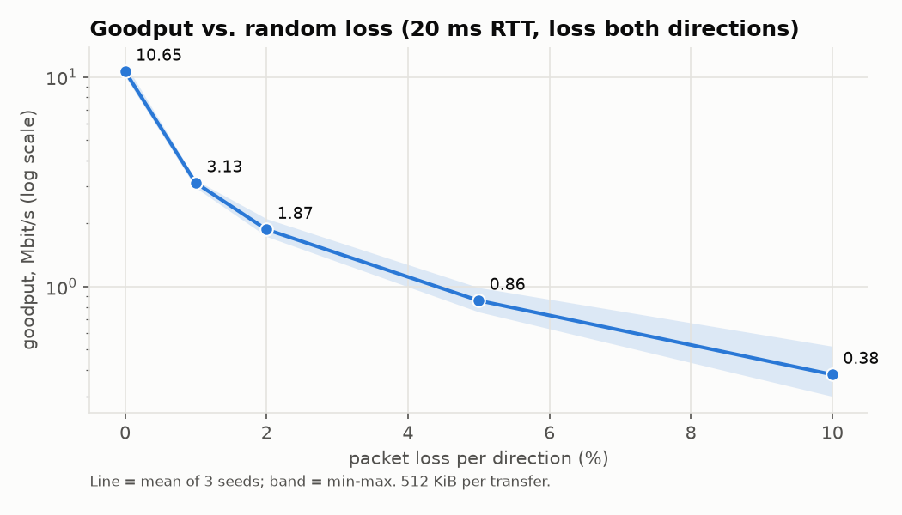
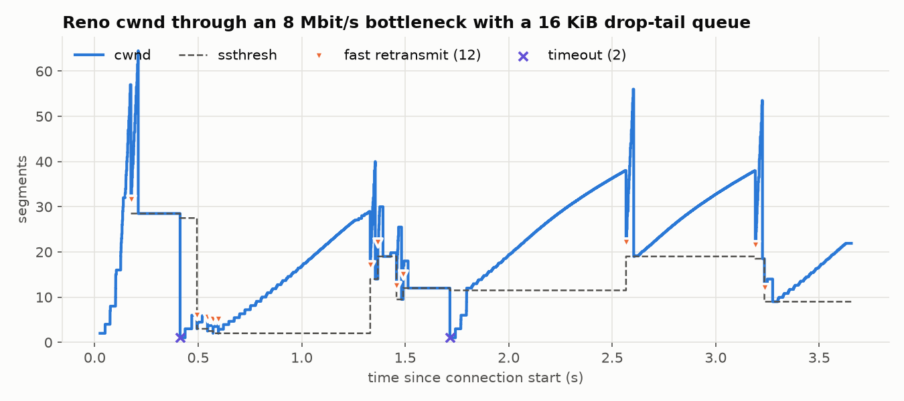
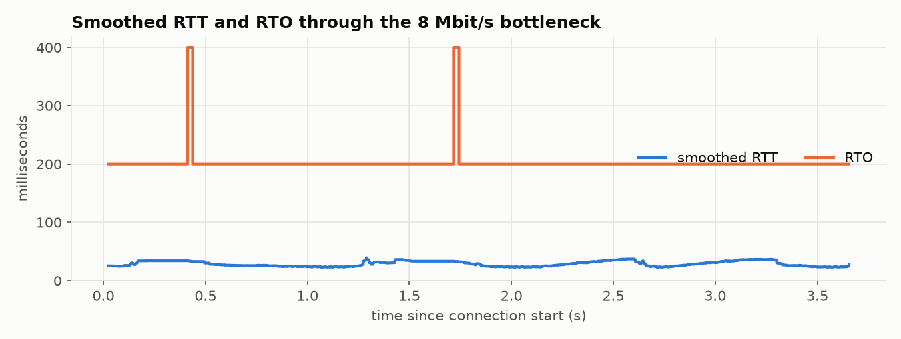

# rudp-transport

A TCP-like reliable transport built on UDP sockets in pure Python (standard library only).
It does a 3-way handshake, delivers a byte stream in order over a lossy network using a
sliding window with cumulative ACKs, adapts its retransmission timeout to the measured
RTT, runs TCP Reno congestion control, and closes with a FIN exchange.

It ships with a **network-impairment proxy**, a UDP relay that adds loss, delay, jitter
(reordering), duplication, corruption, and a rate-limited bottleneck with a drop-tail
queue. It stands in for Linux `tc netem`, so the same experiments run on macOS and Linux.

This is a TCP-*like* protocol: it follows the RFC algorithms named below, but its wire
format is its own and it does not interoperate with real TCP.

## What's implemented

| Area | Behavior | Reference |
|---|---|---|
| Wire format | 25-byte header: seq, ack, flags (SYN/ACK/FIN), window, length, tsval, tsecr, CRC32 | — |
| Connection setup | 3-way handshake with random ISNs; SYN and SYN-ACK retransmitted with backoff; a lost handshake ACK is recovered from the first data segment | RFC 9293 §3.5 |
| Teardown | FIN → FIN-ACK → ACK, with TIME_WAIT on the sender to re-ACK a lost FIN-ACK | RFC 9293 §3.6 |
| Reliability | Cumulative ACKs; receiver buffers out-of-order segments (64-segment window) and ACKs every arrival, so gaps produce duplicate ACKs | RFC 9293 |
| Flow control | Receiver advertises free buffer; sender sends `min(cwnd, rwnd)`; one-segment probe when the window is zero | RFC 9293 §3.8.6 |
| RTO | Jacobson/Karels SRTT/RTTVAR, `RTO = SRTT + 4·RTTVAR`, clamped to [200 ms, 60 s], exponential backoff on timeout | RFC 6298 |
| RTT sampling | Timestamp echo (default), or Karn's rule only (`timestamps=False`) | RFC 7323 §4, RFC 6298 §3 |
| Congestion control | Slow start with byte counting (L = 2), congestion avoidance, fast retransmit on the 3rd duplicate ACK, fast recovery with window inflation/deflation, `cwnd = 1` on timeout; no growth when not cwnd-limited | RFC 5681, RFC 3465, RFC 7661 |
| Integrity | CRC32 over header and payload; corrupted datagrams are dropped and repaired by retransmission | — |

## Layout

```
rudp/
  packet.py      header encode/decode, checksum
  rtt.py         RTO estimator
  congestion.py  Reno state machine
  sender.py      handshake, sliding window, retransmission, teardown, event trace
  receiver.py    connection state machine, reassembly, ACK generation
  proxy.py       impairment relay (loss/delay/jitter/dup/corrupt/bottleneck)
  harness.py     in-process sender → proxy → receiver runner used by tests and benchmarks
  cli.py         run each piece as its own process
tests/           unit tests (packet, RTO, Reno) and end-to-end transfer tests
bench/           benchmark runner and plotting
results/         CSVs, summary.md, and charts from the latest benchmark run
```

## Running it

```bash
python3 -m venv .venv && .venv/bin/pip install -e ".[dev]"
.venv/bin/python -m pytest -q
```

Three processes over real sockets:

```bash
.venv/bin/python -m rudp recv --bind 127.0.0.1:9000 --out received.bin
.venv/bin/python -m rudp proxy --listen 127.0.0.1:9100 --target 127.0.0.1:9000 --loss 0.02 --delay 0.01 --jitter 0.005
.venv/bin/python -m rudp send --to 127.0.0.1:9100 --file input.bin --events events.csv
```

Benchmarks and charts:

```bash
.venv/bin/python bench/run_benchmarks.py
.venv/bin/python bench/plot_results.py
```

## Measured results

All numbers are from `bench/run_benchmarks.py` on loopback (macOS arm64, Python 3.13), with
the impairment proxy adding 10 ms each way (20 ms RTT). Raw data is in `results/loss_sweep.csv`
and `results/summary.md`. Every transfer was checked byte-for-byte (SHA-256) and all 30 were intact.

| loss per direction | goodput, Mbit/s (mean of 3, min–max) | retransmissions | timeouts | fast retransmits |
|---|---|---|---|---|
| 0% | 10.65 (10.09–11.61) | 0 | 0 | 0 |
| 1% | 3.13 (2.96–3.22) | 10 | 1 | 5 |
| 2% | 1.87 (1.74–2.11) | 13 | 2 | 12 |
| 5% | 0.86 (0.76–0.99) | 28 | 9 | 16 |
| 10% | 0.38 (0.30–0.52) | 64 | 28 | 20 |

512 KiB per transfer. The 0% figure is limited by the 64-segment receive window over a
20 ms RTT and by Python's per-packet cost, not by the link.



**Congestion control through a bottleneck.** 2 MiB through an 8 Mbit/s link with a 16 KiB
drop-tail queue and no random loss: 4.56 Mbit/s goodput, 29 queue drops, repaired by
12 fast retransmits and 2 timeouts. The trace shows slow start, the multiplicative cut at each
fast retransmit, linear growth in congestion avoidance, and `cwnd = 1` after each timeout.
The brief spikes are Reno's window inflation during fast recovery.




With 2% random loss instead (`results/cwnd_loss.png`), 1 MiB took 4.81 s (1.74 Mbit/s), with
24 fast retransmits and 3 timeouts.

## A bug the tests found: the Karn's-rule RTO spiral

The first version took RTT samples using Karn's rule only: never sample an ACK that covers
a retransmitted segment. At 20% loss in both directions the transfer stalled. Tracing the
timer showed why. After a timeout the sender goes back to `snd_una` and resends the rest of
the window, so every later ACK covers a retransmission. No sample was ever accepted, the
backed-off RTO was never re-measured, and each further loss doubled it again (0.8 s → 25.6 s).

The fix is the mechanism real TCP uses, an RFC 7323-style timestamp echo. The sender stamps
each segment; the receiver echoes the stamp of the segment at the left edge of its window,
so the ACK that a retransmission triggers measures that retransmission. Karn-only mode is
kept behind `TransportConfig(timestamps=False)` for comparison
(`bench/karn_vs_timestamps_20pct.py`, 100 KB, 20% loss each way, 2 ms delay):

| RTT sampling | outcome | max RTO |
|---|---|---|
| timestamp echo | intact in 11.7 s, 26 timeouts | 3.2 s |
| Karn's rule only | did not finish within 400 s | — |

At 10% loss or less the two modes measured the same (see `results/summary.md`). With a
20 ms RTT the RTO sits at its 200 ms floor either way, so the difference only appears once
losses come back to back.

## Limitations

- Data flows one way per connection (sender → receiver); ACKs flow back. There is no
  bidirectional stream and no listen backlog: a receiver accepts one connection.
- No SACK: after a timeout the sender resends from `snd_una` (go-back), which counts as
  retransmissions even for segments the receiver already buffered.
- Plain Reno, not NewReno: several losses in one window usually end in a timeout.
- Duplicate ACKs are not required to carry an unchanged window (RFC 5681 asks for that),
  because this receiver's advertised window shrinks while it buffers out-of-order data.
- Streams must be under 4 GiB: the 32-bit wire sequence space is unwrapped against the ISN.
- The proxy's bottleneck rate counts UDP payload bytes only, and all measurements are on
  loopback, where Python's per-packet overhead caps throughput.
- Impairment decisions are seeded, but delivery timing depends on the OS scheduler, so
  repeated runs pick the same packets to drop and land close to each other rather than
  identical.
